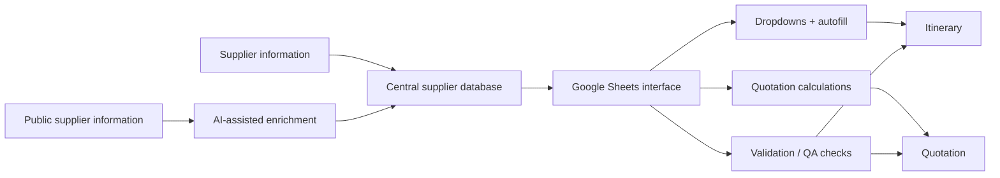

# Travel Operations Automation Case Study

This repository is a public case study of an internal system I designed and built during an 8-week IT internship at **Tricolage**, a small travel company in Tokyo.

The production code, company data, supplier information, and internal screenshots are not included because the system was built for internal use and is still used by the company. The examples in this repository use simplified, synthetic data to show the kind of problems the system was designed to solve.

## What I built

The company was creating itineraries and cost quotations through a mostly manual process. Information about hotels, transportation, experiences, agents, and other suppliers was spread across different sheets and sources, which meant staff had to repeatedly search, copy, paste, check, and recalculate information.

I designed and implemented a system that brought those pieces together into a more structured workflow.

The system included:

- A centralized supplier database for hotels, transportation, experiences, and other services
- Google Sheets interfaces for itinerary and quotation creation
- Google Apps Script automation for dropdowns, autofill, validation, and calculations
- Gemini API integration for AI-assisted data entry and enrichment
- RAG-style workflows for gathering and updating supplier information
- Data validation and QA checks to catch missing or inconsistent information
- Manual override options for cases where staff needed flexibility
- Logging and simple queue-based processing for supplier-data updates

The goal was not to replace the staff's judgment. It was to remove repetitive work and make the information they were already using easier to access and more consistent.

## Result

The system reduced parts of the itinerary and quotation process from **hours to minutes** and improved consistency across the workflow.

The project also became part of the team's day-to-day process after my internship ended, which was the most rewarding part of the work for me.

## My role

I worked on the project independently during the internship and was responsible for:

- Understanding the existing workflow and identifying where automation would actually help
- Designing the data structure and relationships between supplier, itinerary, pricing, and agent information
- Building the Google Sheets and Apps Script workflow
- Integrating the Gemini API
- Designing prompts for data enrichment and normalization
- Adding validation, error handling, and manual-review steps
- Testing the system with real business workflows and adjusting it based on staff feedback

Because the company was small, I was able to work directly with the people using the system and make changes based on how the workflow worked in practice and any requests or concerns the team had.

## Technology

- Google Apps Script
- Google Sheets
- Google Gemini API
- Structured supplier databases
- RAG-style data retrieval and enrichment
- Prompt engineering
- Data validation and normalization

## High-level workflow

## Example: supplier data structure

The production system used the company's real supplier information. The example below is intentionally simplified.

| **supplier_name**     | **category**   | **location** | **pricing_type** | **description**                    | **status** |
| --------------------- | -------------- | ------------ | ---------------- | ---------------------------------- | ---------- |
| Example Hotel Tokyo   | Accommodation  | Shinjuku     | Per person       | Boutique hotel near central Tokyo | Active     |
| Sample Cycling Tour   | Experience     | Setagaya     | Per person       | Guided half-day cycling tour      | Active     |
| Demo Transfer Service | Transportation | Tokyo        | Per group        | Private airport transfer          | Active     |

A synthetic CSV with similar example data is included in [`examples/synthetic_supplier_data.csv`](examples/synthetic_supplier_data.csv).

## Example: automation logic

The production Apps Script is proprietary, so I have not copied it here. Instead, [`examples/workflow_example.js`](examples/workflow_example.js) shows a simplified version of the supplier-data enrichment workflow.

The example:

- Scans a Google Sheets-style supplier database for incomplete records
- Reads the supplier information that is already available
- Sends only missing fields to a small processing queue
- Builds a Gemini prompt asking for specific missing public information
- Requests consistent formatting and uses `N/A` when information cannot be verified
- Parses the structured response and writes only missing values back to the sheet
- Marks AI-assisted updates for staff review
- Logs completed and failed enrichment attempts

This is not production code. It uses synthetic data and does not contain Tricolage source code, company data, internal prompts, credentials, or proprietary business logic.

## AI-assisted data work

One of the more interesting parts of the project was helping clean and maintain the supplier database.

Some supplier records had missing fields, inconsistent formatting, or different data types. I built an AI-assisted workflow where the system could:

1. Read the information already available for a supplier
2. Identify fields that were missing or inconsistent
3. Research or retrieve public information when appropriate
4. Normalize values into a consistent format
5. Fill required fields or return `N/A` when the information was not applicable or could not be verified
6. Leave the result available for staff review

I also added queueing and logging so the process could be run in smaller batches and failures could be reviewed instead of silently ignored.

## What I learned

The biggest lesson from this project was that useful automation is usually less about adding as much technology as possible and more about understanding the workflow first.

A lot of the work involved small decisions: where staff needed a manual override, when a missing field should block the process, what should be automated, and what should still require human review.

That experience made me especially interested in software, data, and AI work that is tied closely to real operations.

## Why this repository is a case study

This repository intentionally does **not** contain:

- Tricolage source code
- Internal company data
- Real supplier records
- Internal screenshots
- API keys, prompts containing company information, or private documents

The purpose is to describe the system and my engineering work without exposing anything that belongs to the company.
